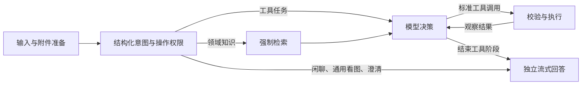

# 古建筑 Agent · LangGraph ReAct

从零重写的本地演示服务。FastAPI 提供 HTTP/SSE，显式 LangGraph StateGraph 执行受控 ReAct，DeepSeek `deepseek-flash` 负责意图、工具决策与回答，硅基流动 `BAAI/bge-m3` 提供 1024 维嵌入。没有本地推理、登录或语音服务。

## 启动

需要 Python 3.13、uv；在本目录执行：

```powershell
uv sync --locked
Copy-Item .env.example .env  # 仅在尚无 .env 时执行，已有文件不要覆盖
# 编辑 .env，填写 DEEPSEEK_API_KEY、SILICONFLOW_API_KEY
uv run python -m app.cli build-kb
uv run uvicorn app.main:app --host 127.0.0.1 --port 8001
```

前端在另一终端运行 `npm ci`、`npm run dev`。视觉服务沿用 `../ancient_arch_backend/` 的启动方法，默认地址 `http://127.0.0.1:8000`。Agent 的文字问答不导入 PyTorch 或视觉服务 Python 包。

依赖以 `pyproject.toml` 和 `uv.lock` 为准。旧 `requirements*.txt`、本地模型依赖、认证、TTS 和规则路由均已移除。真实 `.env` 不会由程序创建或改写。旧 `SILICONFLOW_MODEL`、`LOCAL_MODEL_*`、`AUTH_*`、`TTS_*` 配置不再生效；硅基流动密钥只用于嵌入。

## 执行架构



- `main` 只负责生命周期与接口；`service` 管理请求互斥、总时限、持久化和响应适配。
- `graph` 定义意图、检索、决策、工具和回答节点；中间决策不会直接输出给用户。
- `providers` 封装 ChatDeepSeek 与嵌入 API；明确传递 `thinking: {type: disabled}`，不保存思考链。
- `toolbox` 校验工具 schema、操作权限和附件归属；`vision` 只调用原视觉 HTTP API。
- `storage/assets` 保存 SQLite 投影、附件元数据和图片文件；LangGraph SQLite checkpointer 保存图执行状态。
- `knowledge` 管理不可变知识库快照和 NumPy 精确余弦检索，不是 ANN 或独立向量数据库。

支持单图/多图匹配、分割、修复、先分割后修复、编号预览、知识检索。一般图片内容由 DeepSeek 看图回答。普通识别不会授权分割或修复。复杂指令依赖模型的意图识别和工具选择，离线测试不代表真实模型的任务成功率。

视觉接口只接受上传文件。工具产物下载为本地附件后，再以 multipart 上传给下一接口。分割后的 crop 调用普通 `/repair`，不会调用会再次分割的 `/repair/segmented`。HTTP 200 仍须检查 `success`。伪 mask 的方法和权重状态会保留给回答节点。

模型编号来自现有元数据及补丁；预览先检查 GLB/OBJ 是否存在。匹配成功但三维文件缺失时保留候选信息，返回资源不可用说明，不返回虚假的预览成功指令。分类置信度不是准确率或建筑鉴定结论。

## 会话与限额

默认 `storage/runtime/agent.sqlite3` 保存会话、完整轮次、附件记录和图 checkpoint；图片存于同级 `assets/`。上传图片只在请求模型时转成临时多模态内容，数据库和 checkpoint 不含图片 base64。

前端只记住当前会话 ID，刷新从服务端恢复。旧浏览器消息不自动迁移。新建保留旧服务端记录但不增加历史列表；清空会删除当前会话、checkpoint 和本地附件，不删除视觉后端的文件。失败和取消轮次可显示，但不加入后续模型历史。重启不会自动重放未完成工具任务。

默认复用最近一次上传批次，派生产物沿用该批次。多张图且指代不清时要求指定序号。上下文保留预算内最近的完整轮次，工具调用和结果不拆开；`CONTEXT_CHAR_BUDGET` 是字符预算，不是精确 token 计数。

每批最多 5 张 JPEG/PNG/WebP，每张 10 MiB、2500 万像素；每轮最多 8 次工具请求，总时限 240 秒，单次外部请求 60 秒。参数纠正或临时错误每种工具最多允许一次重试；重试与重复调用均计入总预算。不会无限重试缺失资源和凭据错误。

同一会话的并发发送和清空返回 409。断开连接会取消后续本地执行；已经发送到远程服务的计算不能保证撤销。本版面向单进程、本机免登录演示，按上述命令运行一个 worker。

## 替换知识库

```powershell
# 首次按保留的 44 个旧文本块建库
uv run python -m app.cli build-kb
# 日后换文件或整个资料目录
uv run python -m app.cli build-kb --source "D:/资料/古建筑"
```

支持 PDF、UTF-8 TXT/Markdown，以及具有 `chunk_id/source/page/text` 的文本块 JSON 数组。扫描 PDF 需要事先 OCR。本仓库没有原知识库 PDF；当前 44 块是历史文本缓存，保留来源和真实页码，不代表本次核验了原文准确性。

新文件按页/文件切块，默认 1000 字符、重叠 150；JSON 保留原切块，单块须非空且不超过 2000 字符。TXT/Markdown 没有页码，返回 `page: null`。重复 chunk_id 会拒绝构建。

构建时调用 BGE-M3、校验 1024 维并归一化，写入独立版本目录；模型、资料指纹、块数和切块设置存入 manifest。全部成功后原子更新 `CURRENT`，失败不会破坏旧索引。模型或维度不匹配时拒绝检索。重启 Agent 加载新索引；旧快照保留以便检查，不自动删除。

检索默认 top 4，结果含片段、来源、页码和分数。分数不等于回答可信度；回答节点须判断片段是否支持结论，使用 `[1]` 等编号引用。无资料或检索失败时说明依据不足；越界引用使请求标记失败。引用支持程度仍需用真实问题进行语义核验。

## API

| 接口 | 行为 |
| --- | --- |
| `GET /health` | 服务存活、凭据是否配置、知识索引状态；不把配置存在当作 API 已验证 |
| `GET /agent/models` | 单个 DeepSeek API 模型 |
| `POST /agent/chat` | 一次性 JSON 回答 |
| `POST /agent/stream` | 同一执行链的 SSE 回答 |
| `GET /agent/conversations/{id}` | 恢复当前会话的消息、附件和最后完成结果 |
| `DELETE /agent/conversations/{id}` | 删除会话、checkpoint 和本地附件 |
| `GET /agent/assets/{id}` | 读取本地图片附件 |

聊天输入为 multipart：`message`、可选 `conversation_id`、`image` 或重复 `images`。兼容接收但忽略 `history`；`model_provider` 可省略或为 `api`，`local` 明确拒绝。

SSE：`session` 提供会话 ID；`analyzing/finalizing/tool_start/tool_end/tool_error` 提供进度；`answer_delta` 为 `{content}`；`final` 为完整响应；`error` 为 `{error,conversation_id}`；`done` 为 `[DONE]`。工具错误可恢复，不等于请求级 `error`。最终响应保留 `tool_result/rag_hits/render_instruction/tool_calls/artifacts/ui_instruction/status_trace`。

## 验证

```powershell
uv run pytest -q
uv run ruff check app tests
# 显式启用少量真实联调；需要自己配置有效密钥和视觉服务
$env:RUN_LIVE_TESTS = '1'
uv run pytest tests/test_live.py -q -rs
```

默认全部是离线测试，真实联调显式跳过。Windows 受限执行环境可能阻断 asyncio 的本机 socketpair，需要允许本机事件循环运行；不要把此环境限制改成业务代码的事件循环补丁。

本次验证结果、缺失资源和真实联调状态见 [重构验证记录](docs/verification.md)。
