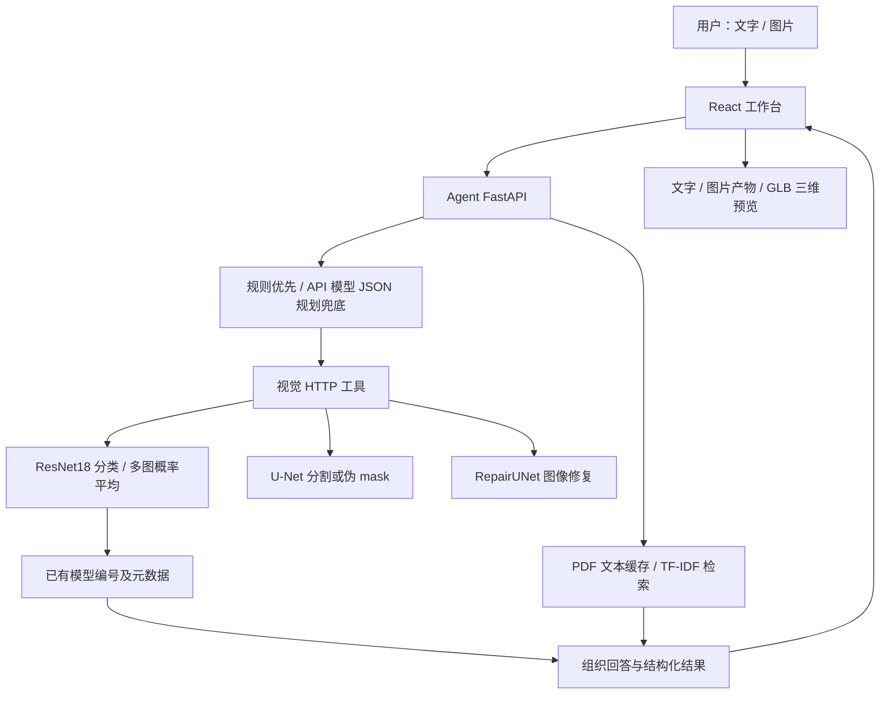

# 智构千年项目分析

分析日期：2026-10-17。范围为当前 `competition-project/`，以三个模块的代码为准。本文没有将其他目录或历史版本的架构套用到当前版本，也不据代码推断个人贡献。

## 1. 可口述的项目定位

> 这是一个面向古建筑斗拱学习和展示的交互平台。用户可以通过自然语言提问，也可以上传图片，请系统进行分割、修复或匹配已有斗拱模型。Agent 服务负责识别意图、调用视觉接口、检索知识片段，并把回答、图片结果和三维展示指令一起返回前端。视觉主路径使用 46 类分类器，将图片匹配到已有模型编号，再关联朝代和名称等元数据。系统还实现了模型预览、一个模型的拆装演示及摄像头背景叠加展示。

这段说明描述系统能力；面试时应另外补充“本人负责哪些部分”，目前材料不足以代填。

我的判断：适合作为 Agent 应用开发的竞赛项目。主要价值在于串联模型、工具接口、知识检索和交互界面；算法效果与完整部署的证据还需补齐。

## 2. 模块和数据流

| 模块 | 目录 | 当前实现与职责 |
| --- | --- | --- |
| 前端 | `ancient-architecture-agent/` | React、TypeScript、Vite；工作台、模型库、聊天、三维展示、拆装及摄像头预览 |
| Agent 服务 | `agent/` | FastAPI；意图路由、视觉 HTTP 工具、知识检索、模型回答、SSE、登录 |
| 视觉与资源服务 | `ancient_arch_backend/` | FastAPI、PyTorch、OpenCV；分类匹配、分割、修复、元数据和静态模型资源 |

上述分支不是每次请求都会全部执行。当前单图匹配直接调用分类接口；分割、修复属于可单独选择的工具。

## 3. Agent 的真实实现

### 工具选择

`agent/app/agent.py` 中的 `ReactAgent.run()` 是主入口：

1. 规范化会话 ID，裁剪传入历史，缓存上传图片。
2. 优先用关键词和模型编号选择工具。
3. 规则未命中时，调用 API 模型返回 JSON，解析 `tool` 和 `model_id`。
4. 按选中的分支执行工具；匹配分支会追加知识检索和回答生成。
5. 返回回答、工具调用记录、产物、三维渲染指令、界面切换指令和状态轨迹。

可选工具包括模型预览、分割、修复、先分割后修复、单图匹配、多图匹配。

虽然类名和 README 使用 ReAct，但当前主执行路径是一次路由后进入固定分支，没有通用的“模型观察工具结果、继续规划并再次调用”的迭代循环。LLM 客户端保留了标准工具定义和 `tool_calls` 解析能力，当前主规划流程使用的是文本 JSON。适宜表述为“规则与大模型结合的工具编排”。

`VisionToolClient.match_uploaded_image()` 保留了分割、修复、分类的组合逻辑，但当前 `run()` 的单图匹配分支调用的是 `predict_single_image()`。不能把保留函数描述为当前所有识别请求的必经流程。

### 知识检索

`agent/app/rag.py` 使用 pypdf 提取文本，按页切块，块长 560 字符、重叠 80 字符。检索采用字符 2～4 gram TF-IDF 和余弦相似度，默认返回最多 4 个片段，默认阈值为 0.02；配置可覆盖默认值。

优点是小语料下实现直接、可解释，片段保留来源和页码。限制是同义表达和复杂语义召回能力需要评测；当前没有看到主链路使用语义 embedding、重排器或向量数据库。

当前目录没有知识库原 PDF，但存在 44 条文本块缓存，代码支持 PDF 缺失时读取缓存。44 是缓存条数，不是问答准确率或测试样本数；原始出处和语义正确性本次没有独立核验。

### 多轮与流式

- 对话文字由浏览器 localStorage 保存并随请求上传；服务端裁剪到最近 20 条、总计最多 8000 字符，没有看到当前路径使用数据库持久化会话。
- 图片按会话 ID 保存在进程内，缓存保留最近一次上传批次中的最多 5 张，TTL 为 30 分钟。重启或请求被分配到其他进程后无法保证复用。
- API 问答路径实现增量返回；匹配分支先生成完整答案再推送。本地模型的 `stream_chat()` 也是生成完成后一次返回文本。不能把所有路径统一说成逐 token 流式。
- 选择本地模型主要影响回答生成；工具规划和通用图片理解仍使用 API 客户端，不能据本地选项宣称整个请求全离线。

## 4. 视觉能力的边界

| 能力 | 代码证据 | 合适的表述 |
| --- | --- | --- |
| 单图匹配 | `app/models/encoder.py`、`app/services/predict_service.py` | ResNet18 主干加分类头，对已有 46 组进行闭集分类并关联资源 |
| 多图匹配 | `PredictService.predict_multi_from_bytes_list()` | 各图 softmax 概率等权平均后选类别；不是三维重建或学习式多视角融合 |
| 朝代与名称 | 分类结果关联 `metadata_service` | 由模型编号查元数据；不是独立的通用建筑断代模型 |
| 分割 | `app/services/segment_service.py` | 有权重时走 U-Net，无权重时走颜色和形态学伪 mask |
| 修复 | `app/services/repair_service.py`、`app/datasets_repair.py` | RepairUNet 二维图像修复；训练数据通过随机遮挡完整图构造 |
| 三维 | 分类结果返回 OBJ/GLB URL | 匹配并展示已有三维资源，不能写成从照片生成全新三维几何 |

本地有分类和修复权重文件，但没有默认的 `seg_best.pth`。因此在默认路径下，分割会走伪 mask；权重文件存在也不等于本次已成功加载或效果达标。

分类概率低于默认 0.4 时仅修改提示文字，仍返回 `success=True` 和候选类别。softmax 分数不能直接当作正确率，当前没有完整的未知类别拒识机制。单图分支有 API 视觉预判，但失败时会继续匹配，多图分支也没有同等预判。

## 5. 前端的价值与限制

较值得讲解的是结构化协议：后端返回 `artifacts`、`render_instruction`、`ui_instruction`，前端据此展示图片、选择模型和切换视图，不依靠从自然语言回答中解析 URL 或界面操作。这是项目中比较清楚的 Agent 应用设计点。

当前拆装配置仅覆盖 1 号模型，节点分组、展开偏移和装配步骤来自手工配置，不能称为任意模型自动拆装。

当前工作台接入的 `ARAssemblyPreview.tsx` 使用摄像头视频和透明 Three.js 场景叠加，模型可交互；没有看到该入口使用空间追踪、平面检测或世界锚点。应称为摄像头叠加预览。`dist` 中的旧 AR 页面不能作为当前源码入口的能力证据。

当前工作台人物展示使用图片帧切换，结合 TTS/浏览器语音播报；仓库另有 `DigitalHuman3D.tsx` 文件，但不能据文件名宣称当前工作台实现了实时三维数字人口型驱动。

## 6. 需要优先处理的问题

### A. 资源打包不完整，影响本地演示

当前视觉后端没有默认 `models/`、`models_glb/` 目录；前端 `public/models_glb/` 只有 `1.glb`，但模型列表和分类映射覆盖 46 组。编号预览工具直接拼接 URL 并报告成功，没有检查对应文件能否访问。

README 引用的 `deploy/nginx.conf.example` 也没有随当前目录提供。因此当前代码可以返回 33 号模型 URL，但不能据此认定本地能渲染 33 号模型。远端部署可能另有资源，本次没有访问核实。

面试演示前应先确定演示模型和资源位置，逐个确认 URL 可访问；不要先扩展功能。

### B. 纯知识问题可能被误路由

`_plan_tool_by_rules()` 接收 `has_image`，但内部调用 `should_call_match_tool(..., has_image=True)`，且对“朝代”“模型”等词进行宽泛匹配。

本次直接抽取原有规则方法进行隔离执行，确认无图片时：

| 输入 | 规则结果 |
| --- | --- |
| 不同朝代的斗拱有什么区别？ | `match_single_image` |
| 斗拱模型有哪些？ | `match_single_image` |
| 我想看看第33组模型 | `preview_model(33)` |
| 斗拱有什么作用？ | 无工具计划，继续后续处理 |

根据 `run()` 的缺图分支，前两个问题会要求用户上传图片，而不是正常做知识问答。此处是规则方法的实际隔离执行，加上主流程代码核对；不是完整 HTTP 服务复现。

修正方向是区分一般知识提问与针对某张图片的识别任务，并为这类句子增加路由回归检查。

### C. 算法效果证据不足

本地 `data/raw/` 有 46 个组目录、229 个图片文件；这只是文件统计，没有完成质量、来源和独立性核验。

当前 `train_classifier.py` 读取整个 `data/raw`，未接入已有 split 文件，也没有验证集循环。`test_classifier.py` 和多图脚本主要对指定图片或目录推理，没有形成独立测试集的汇总指标。不能直接报告测试准确率，也不能证明多图融合优于单图。

存在 5 个 epoch 的修复训练 loss 日志，但 loss 降低不等于真实残损图上的恢复正确性。分类、检索、修复和回答正确性需要各自评测。

### D. 访问控制和运行隔离尚不完整

Agent 的聊天接口挂有登录依赖，但视觉后端 `/predict`、`/segment`、`/repair` 路由没有挂对应鉴权。若视觉端口对外可访问，可以绕开前端登录直接调用。这是当前路由代码的边界；生产环境是否另有网关保护待核实。

视觉 API 的 `async def` 处理函数直接执行同步推理，可能阻塞该进程事件循环；本次未做并发或性能测试。应先确定演示并发需求，再考虑推理执行隔离。

图片缓存仅以客户端会话 ID 为键，没有绑定认证用户，也没有全局会话数量或字节上限；上传入口未见应用层文件数量、体积限制。当前更适合受控演示环境。

### E. 工具规划输出校验不充分

模型输出虽经 JSON 解析，但没有完整 schema 校验。例如 `preview_model` 缺失 `model_id` 时仍可能形成计划，随后在执行分支触发断言；合法 JSON 若不是对象，也可能在 `.get()` 处出错。应在计划形成时校验类型、工具参数和范围，并返回可解释的失败信息。

## 7. 本次检查记录

| 检查 | 结果 | 说明 |
| --- | --- | --- |
| 前端 `node node_modules/typescript/bin/tsc --noEmit` | 通过，退出码 0 | 类型检查，不代表浏览器交互及资源加载成功 |
| 选定 Python 目录 AST 语法解析 | 69 个文件无语法错误 | 覆盖 Agent app/tests、视觉 app/scripts/tests，不等于依赖导入和运行成功 |
| 直接执行已有 `test_intent.py` 的 4 个测试函数 | 4 个通过 | 未使用 pytest；只覆盖轻量意图函数 |
| 抽取已有路由方法隔离执行 | 确认上述误路由 | 未启动完整服务 |
| 本地资源、缓存、配置入口核对 | 已完成静态核对 | 不读取或复述真实 `.env` 凭据 |
| 完整 pytest、分类/修复推理、真实模型问答 | 未执行 | 当前选用 Python 环境缺少 pytest、scikit-learn、PyTorch 等关键依赖；未安装新依赖 |
| 前端生产构建、浏览器/摄像头/三维体验、远端部署 | 未验证 | 现有 dist 和缓存不能替代本次验收 |

本次没有修改业务代码，也没有调用外部模型 API。

## 8. 面试准备建议

优先讲清三个设计点：为什么把 Agent 与视觉服务分开；为什么返回结构化界面指令；为什么对小型固定知识库采用 TF-IDF，以及它的局限。

建议准备以下追问：

1. “这算 ReAct 吗？”——解释当前是规则与模型结合的固定工具编排，并说明真正迭代规划还缺什么。
2. “图像到三维怎么实现？”——说明图片分类、编号映射、已有模型资源加载的流程。
3. “如何判断答案可靠？”——分别回答分类评测、检索相关性、知识出处和最终回答语义核验；不要只给一个综合准确率。
4. “为什么有图片缓存？”——支持后续‘把刚才的图分割出来’，同时承认进程内缓存的重启和多 worker 限制。
5. “一次失败案例是什么？”——可讲纯知识问题误入匹配分支，以及如何区分图片指代和一般知识意图；不要把本次分析发现写成本人过去已经修复的经历。

还需用户材料确认：竞赛时实际使用的版本、个人承担的模块、AI 辅助程度、真实联调及比赛结果、数据与模型资源来源。当前目录没有可读取的简历文件来确认这些事实，因此本文不生成个人成果、奖项或准确率表述。
